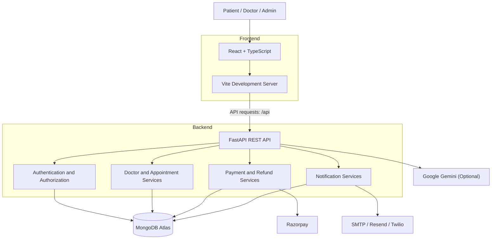
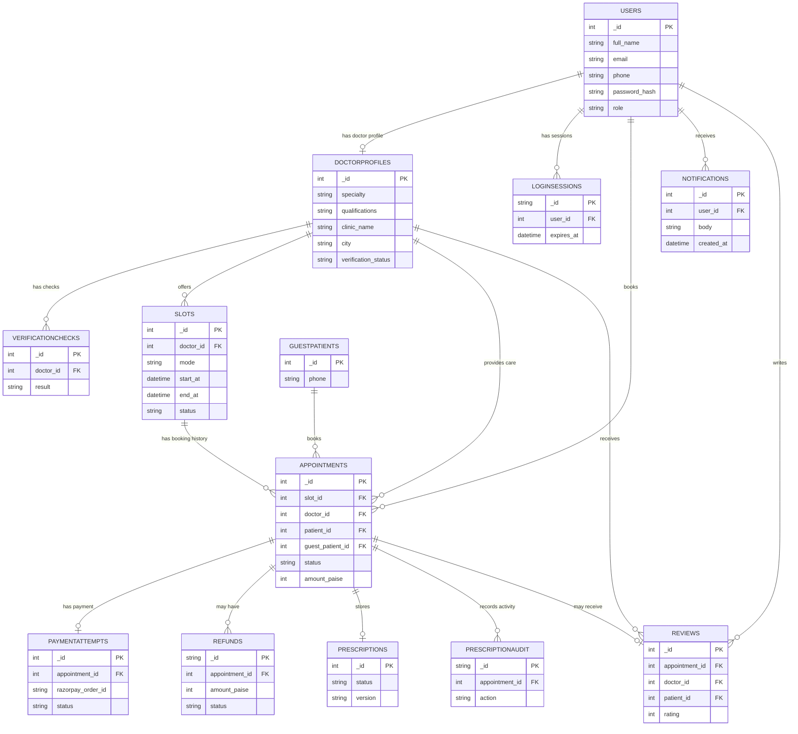

# MediConnect

**A full-stack healthcare appointment booking platform for patients, doctors, and administrators.**

MediConnect makes it easier for patients to find doctors and book clinic or online consultations. Doctors can manage their profiles, availability, and appointments, while administrators can manage users and review doctor applications.

## Features

### Patient

- Register and log in securely.
- Search doctors by specialty, city, consultation mode, fees, and availability.
- Book clinic or online consultations.
- Make payments using Razorpay.
- View and manage appointments.
- Receive notifications and submit reviews.
- Upload prescription photos when the feature is enabled.

### Doctor

- Manage doctor profile and practice details.
- Add and manage available appointment slots.
- View upcoming and previous appointments.
- Manage clinic and online consultation availability.

### Administrator

- Review doctor applications.
- Manage user accounts and appointments.
- Suspend or reactivate accounts.
- Review platform activity.

### Guest booking

- Book eligible urgent appointments without creating a full patient account.
- Verify a mobile number before booking.

---

## Technology Stack

| Part                       | Technology               |
| -------------------------- | ------------------------ |
| Frontend                   | React 19, TypeScript     |
| Frontend tooling           | Vite 6                   |
| Routing                    | React Router             |
| Backend                    | Python 3.13, FastAPI     |
| API server                 | Uvicorn                  |
| Database                   | MongoDB Atlas            |
| Database connection        | PyMongo                  |
| Payments                   | Razorpay                 |
| Email                      | SMTP / Resend            |
| SMS verification           | Twilio                   |
| AI prescription processing | Google Gemini (optional) |
| Testing                    | Pytest, Mongomock        |
| Deployment                 | Docker, Render           |

---

## Application Architecture

The frontend is built with React and communicates with the FastAPI backend through API requests. The backend handles authentication, appointments, payments, notifications, and database operations.



### How it works

1. A user opens MediConnect in a browser.
2. The React frontend displays the website and handles user interactions.
3. The frontend sends API requests to FastAPI.
4. FastAPI processes requests and reads or updates MongoDB.
5. For enabled features, the backend communicates with services such as Razorpay, Twilio, Resend, and Google Gemini.

**Development:** Vite runs on port `5173` and forwards API requests to FastAPI on port `8000`.

**Production:** The frontend build is placed in `backend/app/static`, and FastAPI can serve the built website.

---

## Database Architecture

MediConnect uses MongoDB collections to store user accounts, doctor profiles, appointment slots, bookings, payments, and other application data.

The following is a simplified diagram of the main database relationships.



### Important database notes

- `users` stores patient, doctor, and administrator account information.
- `doctorprofiles` stores a doctor's professional and clinic details separately from their account.
- `slots` stores available clinic and online consultation times.
- `appointments` connects patients or guest patients with doctors and slots.
- `paymentattempts` and `refunds` store payment-related information.
- `prescriptions` stores prescription data associated with an appointment.
- `reviews` stores patient feedback about completed appointments.

MongoDB uses document references rather than SQL foreign keys. The application checks these relationships, and database validators and indexes help maintain data consistency.

For the complete collection structure and rules, see [`docs/DATABASE.md`](docs/DATABASE.md).

---

## Run MediConnect Locally

Follow these steps to run the project on your computer.

### 1. Prerequisites

Install the following software:

| Software | Required version                                |
| -------- | ----------------------------------------------- |
| Python   | 3.13                                            |
| Node.js  | 22 LTS or newer                                 |
| pnpm     | 11                                              |
| MongoDB  | MongoDB Atlas or another replica-set deployment |
| Git      | Latest stable version                           |

MongoDB Atlas is recommended. The booking and payment workflows use database transactions, which require MongoDB replica-set support.

### 2. Clone the repository

Open your terminal and run:

```bash
git clone https://github.com/harsh001-debug/MediConnect.git
cd MediConnect
```

Install pnpm if it is not already installed:

```bash
npm install --global pnpm@11.19.0
```

### 3. Configure environment variables

Create your local environment file from the example.

**Windows PowerShell:**

```powershell
Copy-Item backend/.env.example backend/.env
```

**macOS / Linux:**

```bash
cp backend/.env.example backend/.env
```

Open `backend/.env` and configure at least your MongoDB connection:

```env
MONGODB_URI=your_mongodb_connection_string
MONGODB_DB_NAME=mediconnect
APP_ENV=development
```

You can configure the other services in the same file:

| Variable group     | Used for                         |
| ------------------ | -------------------------------- |
| MongoDB variables  | Database connection              |
| Email variables    | Email verification and recovery  |
| Twilio variables   | SMS verification                 |
| Razorpay variables | Payments and refunds             |
| Gemini variables   | Optional prescription processing |

Use your own credentials and test-mode keys. Do not commit `backend/.env` to GitHub. The repository includes `backend/.env.example` as a safe template.

### 4. Start the backend

Open a terminal at the project root:

```bash
cd backend
```

Create a Python virtual environment:

```bash
python -m venv .venv
```

Install the backend dependencies.

**Windows PowerShell:**

```powershell
.\.venv\Scripts\python.exe -m pip install -r requirements-dev.txt
```

**macOS / Linux:**

```bash
./.venv/bin/python -m pip install -r requirements-dev.txt
```

Start the FastAPI server.

**Windows PowerShell:**

```powershell
.\.venv\Scripts\python.exe -m uvicorn app.main:app --reload --port 8000
```

**macOS / Linux:**

```bash
./.venv/bin/python -m uvicorn app.main:app --reload --port 8000
```

The backend will run at:

`http://localhost:8000`

Check the database connection using:

`http://localhost:8000/api/v1/health`

Open the interactive API documentation at:

`http://localhost:8000/docs`

A successful health response looks like:

```json
{
  "status": "ok"
}
```

### 5. Start the frontend

Open a **second terminal** at the project root:

```bash
cd frontend
```

Install the frontend dependencies:

```bash
pnpm install --frozen-lockfile
```

Start the Vite development server:

```bash
pnpm dev
```

Open the website in your browser:

`http://localhost:5173`

The frontend automatically forwards API requests to the backend running on port `8000`.

### 6. Create local demo accounts (optional)

You can create local administrator and patient accounts, along with fictional demo doctors and appointment slots.

In `backend/.env`, configure the seed values. For example:

```env
SEED_ADMIN_EMAIL=admin@example.com
SEED_ADMIN_PASSWORD=change-this-password

SEED_PATIENT_EMAIL=patient@example.com
SEED_PATIENT_PASSWORD=change-this-password

SEED_DEMO_DATA=1
SEED_DOCTOR_PASSWORD=change-this-password
```

Then, from the `backend` directory, run:

**Windows PowerShell:**

```powershell
.\.venv\Scripts\python.exe seed.py
```

**macOS / Linux:**

```bash
./.venv/bin/python seed.py
```

The seed script creates the configured accounts and, when demo data is enabled, fictional doctor profiles and slots. Use a development database for this process.

---

## Project Structure

```text
MediConnect/
│
├── backend/
│   ├── app/
│   │   ├── api/              # API endpoints
│   │   ├── models.py         # Database record models
│   │   ├── db.py             # MongoDB connection and operations
│   │   ├── database_schema.py# Collection rules and indexes
│   │   └── main.py           # FastAPI application entry point
│   │
│   ├── tests/                # Backend tests
│   ├── .env.example          # Environment variable template
│   ├── requirements.txt      # Backend dependencies
│   ├── requirements-dev.txt  # Development and test dependencies
│   └── seed.py               # Demo account and data setup
│
├── frontend/
│   ├── src/
│   │   ├── components/       # Reusable UI components
│   │   ├── pages/            # Website pages
│   │   └── App.tsx           # Main frontend application
│   │
│   ├── package.json
│   └── vite.config.ts
│
├── docs/
│   └── DATABASE.md           # Detailed database documentation
│
├── Dockerfile
├── render.yaml
└── README.md
```

### Frontend production build

From the `frontend` directory:

```bash
pnpm build
```

The build output is generated in:

```text
backend/app/static/
```

After building, start FastAPI and open:

`http://localhost:8000`

FastAPI serves the built frontend from that location when the build exists.
