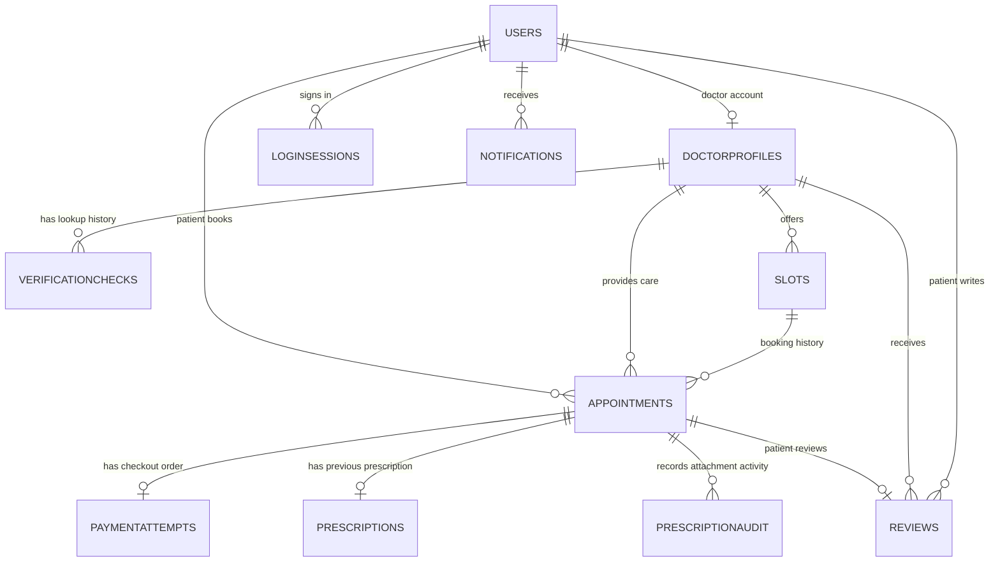

# MediConnect database structure

MediConnect uses MongoDB with separate collections for accounts, doctor practice
details, availability, bookings, payments, and reviews. Existing collection names
and IDs are retained so current accounts, sessions, and bookings continue to work.

The executable contract is `backend/app/database_schema.py`. Python record
types live in `backend/app/models.py`, and `backend/app/db.py` explicitly maps
each model to its collection and primary key.

## Relationships



Relationships are references checked by application logic and the audit command;
MongoDB JSON Schema does **not** implement foreign keys. A slot can have multiple
historical appointments after cancellation or expiry, while its atomic hold
allows only one current booking. Slot records with appointment history are kept.

## Collections

Administrator access can also be granted to an existing patient or doctor with
the optional `users.admin_access` boolean. Its default is false for older
records. The original role and appointment references are preserved. Granting
access increments the session generation and records a `grant_admin` action.
The account appears as an administrator in sign-in responses and account lists.

| Collection | Primary key | Contents and relationships |
| --- | --- | --- |
| `users` | Integer `_id` | Account identity, role, password hash and optional contact verification timestamps and active challenges. |
| `doctorprofiles` | `_id` equals doctor `users._id` | One practice profile per doctor: registration, qualifications, specialty, experience, clinic/address/city, clinic and online fees, verification state and review note. |
| `loginsessions` | SHA-256 token hash `_id` | `user_id`, `expires_at`. Raw session tokens are never stored. |
| `authratelimits` | Hashed fixed-window key `_id` | Atomic request counts and an expiry timestamp for login, signup and code delivery limits. |
| `passwordresetchallenges` | HMAC-derived email key `_id` | Single-use email recovery code digest, user reference, session generation, attempt count and expiry. A TTL index removes expired challenges. |
| `guestpatients` | Integer `_id` | Guest identity keyed by verified mobile number. |
| `guestsessions` | SHA-256 token hash `_id` | `guest_id` and session expiry. |
| `guestchallenges` | Keyed phone digest `_id` | Hashed challenge token, code digest, attempt count and expiry. |
| `verificationchecks` | Integer `_id` | Doctor reference, lookup outcome, source URL, matched name, details, checked timestamp. |
| `slots` | Integer `_id` | Doctor reference, clinic/online mode, start/end, status, hold deadline and current appointment reference. |
| `appointments` | Integer `_id` | Registered patient or guest reference, doctor and slot references, booking state and cancellation details. |
| `paymentattempts` | Integer `_id` | Appointment reference, unique Razorpay order, optional unique payment ID, payment state and creation timestamp. |
| `prescriptions` | `_id` equals appointment `_id` | Private normalized photos, versioned consent, extraction entries and state, worker lease, and retention deadlines. |
| `prescriptionaudit` | MongoDB ObjectId `_id` | Appointment and actor IDs, action, optional source page number, timestamp, and expiry. |
| `refunds` | Razorpay payment ID `_id` | One refund request per captured payment. Stores the amount, provider reference, retry deadline and processing lease. |
| `reviews` | Integer `_id` | One review per appointment: patient and doctor references, integer rating 1–5, comment, creation timestamp. |
| `notifications` | Integer `_id` | Recipient, message, creation and read times, optional event and appointment IDs, and optional email delivery state. |
| `adminactions` | Integer `_id` | Acting admin, affected account or appointment ID, action, reason and timestamp. |
| `counters` | Model name `_id` | Atomic integer sequences for record IDs. Gaps are allowed. |
| `schema_migrations` | Schema version `_id` | Application time for successfully installed schema versions. Created by full schema setup. |

### Identity and authentication

- Suspension increments the account's session generation and sets its suspension time. Pre-upgrade sessions and accounts have generation zero. Reactivation clears the suspension time, and current sessions must have the account's latest generation.
- Email addresses are normalized by the application and have a unique index.
- The `users` collection contains identity only. Doctor practice data is separate;
  patient and admin accounts do not need empty doctor fields.
- Passwords are salted scrypt hashes. Do not put raw passwords or Razorpay secrets
  in profile, booking, payment, or session records.
- Expired session records are cleaned up by a TTL index. Authentication still
  checks `expires_at` on every request; cleanup is asynchronous.
- Each contact challenge stores a keyed digest, a random nonce, its expiry and
  the number of attempts. Confirmation clears the challenge and records the
  verification timestamp in the same atomic update. Existing users can verify
  during sign-in without migrating their account records.

### Money, dates and appointment history

- All stored prices are integer **INR paise**: ₹500 is `50000`. This avoids
  floating-point rounding in payment comparisons.
- Appointment `amount_paise` records the price at booking time. A later doctor
  fee change does not change an existing appointment's amount.
- Timestamps use BSON dates in UTC. The frontend displays them in Asia/Kolkata.
- `registration_date` remains a date-only `YYYY-MM-DD` string for compatibility.
- Cancelling a booking preserves the appointment and payment records. Reviews
  are allowed only for completed appointments and are unique per appointment.
- Each appointment has one checkout order. A cancellation records the actor,
  timestamp and charged deduction. A durable refund record tracks application and
  provider state separately from the appointment.
- A slot with booking history cannot be deleted through the doctor API.

## Allowed states

| Record | States |
| --- | --- |
| User role | `patient`, `doctor`, `admin` |
| Doctor verification | `pending`, `published`, `rejected` |
| Verification method | Empty while pending, `registry_matched`, `admin_review`, `demo_seeded` |
| Registry check result | `matched`, `review`, `unavailable` |
| Slot | `available`, `held`, `booked` |
| Appointment | `pending_payment`, `confirmed`, `completed`, `cancelled`, `expired`, `payment_failed` |
| Payment | `created`, `authorized`, `failed`, `captured`, `paid_after_expiry` |
| Refund | `queued`, `processing`, `processed`, `needs_review` |

Allowed values are enforced by the schema once installed. Allowed **transitions**,
authorization, reference ownership, payment verification, and overlap prevention
remain application responsibilities. Transactions coordinate multi-document
booking/payment changes and require MongoDB Atlas or another replica set.

## Indexes

| Collection | Index purpose |
| --- | --- |
| Users | Unique email; role lookup |
| Sessions | User lookup; TTL on `expires_at` with `expireAfterSeconds: 0` |
| Guest access | Unique mobile number; TTL on guest sessions and SMS challenges |
| Auth rate limits | TTL on `expires_at` |
| Doctor profiles | Unique normalized council + registration; published status/specialty/city |
| Verification checks | Doctor and newest check first |
| Slots | Unique doctor + start time; doctor/status/start; doctor/status/hold expiry |
| Appointments | Patient/newest, doctor/newest, slot/status, guest/newest, one pending hold per guest |
| Payments | Unique appointment, unique order, unique payment ID when present, and due-order lookup |
| Refunds | Appointment lookup and reconciliation by state and deadline |
| Reviews | Unique appointment; doctor; doctor/newest |
| Notifications | Recipient/history, recipient/latest ID, recipient/unread, and email queue by deadline |

The partial unique payment-ID index permits multiple unpaid records with a null
payment ID. Uniqueness on slot start time does not itself prevent overlapping
intervals: the booking/slot APIs also use conditional writes and transactions.
The current doctor search performs substring filtering in Python; compound
indexes are not a claim that those substring searches are database-indexed.

## Audit and setup

From `backend/` with the virtual environment active, run one of these commands.

```powershell
# Read-only: schema shape, duplicate keys and reference/role checks.
python manage_database.py

# Install indexes without changing validators.
python manage_database.py --indexes-only

# Install strict collection validators and indexes after a clean audit.
python manage_database.py --apply
```

All commands use `MONGODB_URI` and `MONGODB_DB_NAME` from `backend/.env` unless
those variables are already set in the process environment. Output contains
counts and issue descriptions, not account data or secrets.

Full setup needs `collMod` permission: use a setup account with `readWrite` and
`dbAdmin` on the target database. The ordinary app account can remain `readWrite`.
Do not grant broad cluster-admin access just to run this setup.

Setup audits existing documents before changing collection options. It never
renames collections, drops existing indexes, or rewrites business documents. It
adds missing collections and records the current schema version only after all steps
succeed. MongoDB collection/index changes are not one atomic transaction; if a
permission or index conflict interrupts setup, resolve it and rerun. Index TTL
cleanup applies to expired sessions, guest challenges and rate-limit windows. Bookings and payment history are kept.

For future model changes, update this contract and audit/migrate old documents
before tightening validators. The validators intentionally reject unknown fields
so misspelled or unsupported fields cannot silently become permanent data.

## Verification

Run the tests from `backend/` with the virtual environment active.

```powershell
python -m pytest -q
```

The default suite uses MongoDB test doubles for API behavior. It checks account
and booking flows, payment uniqueness, schema/model consistency, repeat setup,
demo-seed preservation, and protection of appointment history.

After full validator installation, run the opt-in real MongoDB checks:

```powershell
$env:RUN_MONGO_SCHEMA_TESTS = '1'
python -m pytest -q tests/test_database_schema_live.py
Remove-Item Env:\RUN_MONGO_SCHEMA_TESTS
```

These tests insert only synthetic records inside transactions that are always
aborted. They check acceptance of all nine model document shapes and rejection
of invalid roles, dates, prices, slot durations, statuses, and ratings. They do
not commit demo data, contact payment services, or verify TTL deletion timing.

## MongoDB references

- [JSON Schema validation](https://www.mongodb.com/docs/manual/core/schema-validation/specify-json-schema/)
- [Modify collection validation](https://www.mongodb.com/docs/manual/core/schema-validation/update-schema-validation/)
- [TTL indexes](https://www.mongodb.com/docs/manual/core/index-ttl/)
